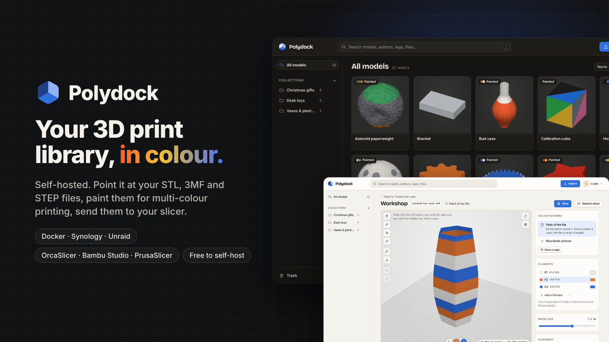
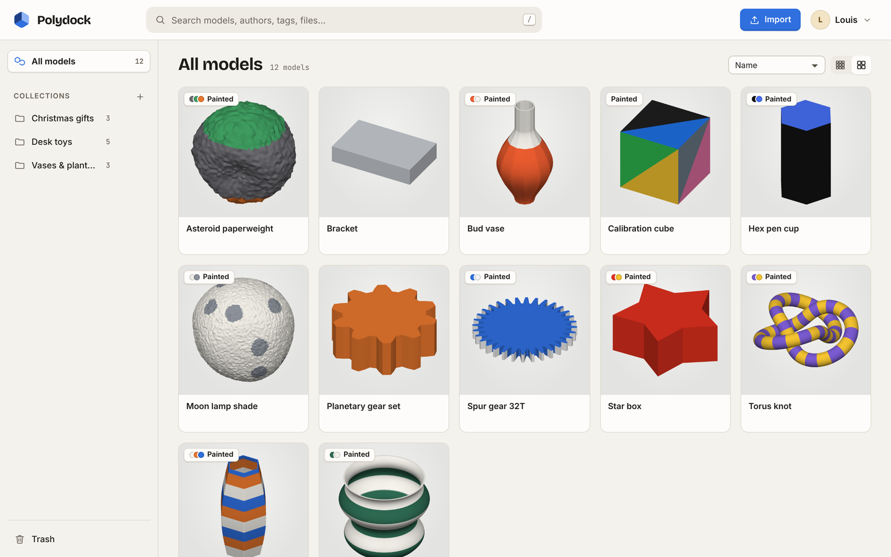
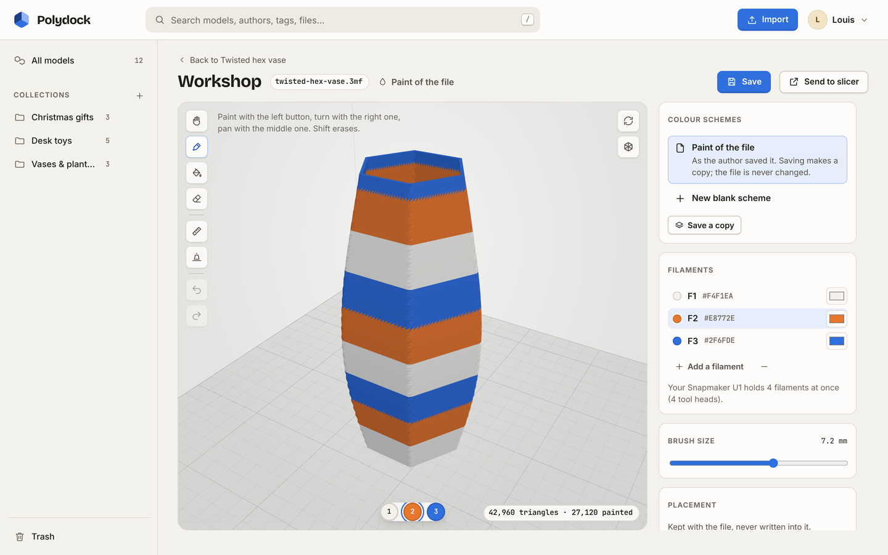
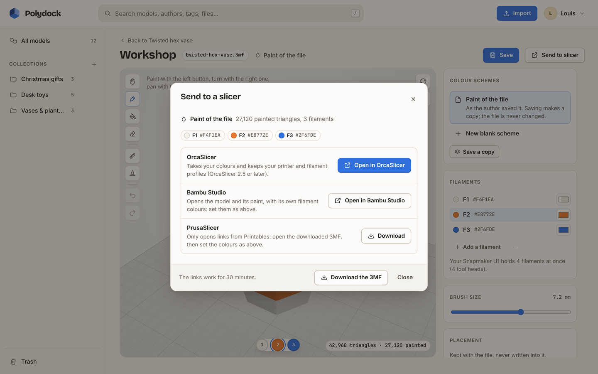

<p align="center"></p>

# Polydock beta

**A self-hosted library for your 3D print files, with a multi-colour paint workshop.**

_En français : [README.fr.md](README.fr.md)._

Polydock points at the folder (or NAS share, or S3 bucket) where your STL, 3MF, OBJ and STEP
files already are, never moves or changes them, and turns them into a library you can search,
tag and sort into collections, with thumbnails and a 3D viewer. You can paint a model for
multi-material printing (AMS, MMU, tool changers) in the browser, keep several colour schemes
per file, and open it in OrcaSlicer, Bambu Studio or PrusaSlicer in one click.

This repository is where the **beta** happens: the install guides, and the place to report
what breaks. Thank you for trying it.

## Screenshots

<p align="center">
  <picture>
    <source media="(prefers-color-scheme: dark)" srcset="assets/screenshots/library-dark.png">
    
  </picture>
</p>

| The paint workshop | Sending to a slicer |
| --- | --- |
|  |  |

## Install

**Without Docker:** the desktop app installs like any other program on Windows, macOS and
Linux. Download it from the [releases](https://github.com/HagridLeVrai/polydock-beta/releases)
and follow the [desktop app guide](docs/install-desktop.md): the installers are not signed
yet, and the guide shows how to open them.

**With Docker**, on a NAS or a server: one container, for amd64 and arm64:

```sh
docker run -d --name polydock -p 3000:3000 \
  -v /path/to/your/models:/library:ro \
  -v polydock-data:/data \
  ghcr.io/hagridlevrai/polydock:beta
```

Then open `http://<the machine's address>:3000`.

- [Installation guide](docs/install.md): Docker Compose, Synology, Unraid, S3 storage, HTTPS,
  updates, backups, troubleshooting.
- [`deploy/docker-compose.yml`](deploy/docker-compose.yml) and the
  [Unraid template](deploy/unraid/polydock.xml).
- [Configuration reference](docs/configuration.md) and
  [how files become models](docs/how-files-become-models.md).

Update with `docker compose pull && docker compose up -d`: fixes ship as new beta versions
under the same `:beta` tag.

## What to try

1. **Connect your collection.** Install, create your account, check in **Settings >
   Libraries** that your models are counted. Browse, search, tag; fix a model that was
   grouped wrongly (merge two models, move a file); import a ZIP from Printables or MakerWorld.
2. **Prepare a multi-colour print.** Open a model in the workshop, paint it with your
   filaments, save the colour scheme, choose your printer, send it to your slicer and print it.
3. **Find it again a few days later**, and send it to the slicer again with the same scheme.

## Report a problem or an idea

[Open an issue](https://github.com/HagridLeVrai/polydock-beta/issues/new/choose). For a bug,
please give the version (**Settings > About**), your machine and browser, what you did, and
the logs (`docker logs polydock`, or **File > Show the log** in the desktop app). French or
English, both are fine.

After a week of use, and again at the end, please fill in the
[feedback form](https://tally.so/r/0VOEoN), about five minutes.

## Known limitations

- **Colours in the slicer:** OrcaSlicer (2.5 or later) receives the filament colours. Bambu
  Studio and PrusaSlicer receive the paint, but the filament colours have to be set by hand.
- **PrusaSlicer** does not open from a link: the 3MF is downloaded.
- **STEP files** get a 3D view, a thumbnail and can be sent to the slicer, but cannot be
  painted yet. Files over 256 MB are only listed.
- **S3 libraries** are read-only and rescanned every hour.
- **One account** per installation.
- **No cut, text or repair tools yet**: they come after the beta.
- With the models folder mounted read-only (`:ro`, recommended), deleting in Polydock only
  hides files.

## About

Polydock is free software under the GNU AGPL v3, developed by a solo maintainer with the
help of AI coding tools; its source code will be published at the public release. A paid
hosted version may come later, for people who would rather not run a server. "Polydock" is a
trademark of its maintainer.
